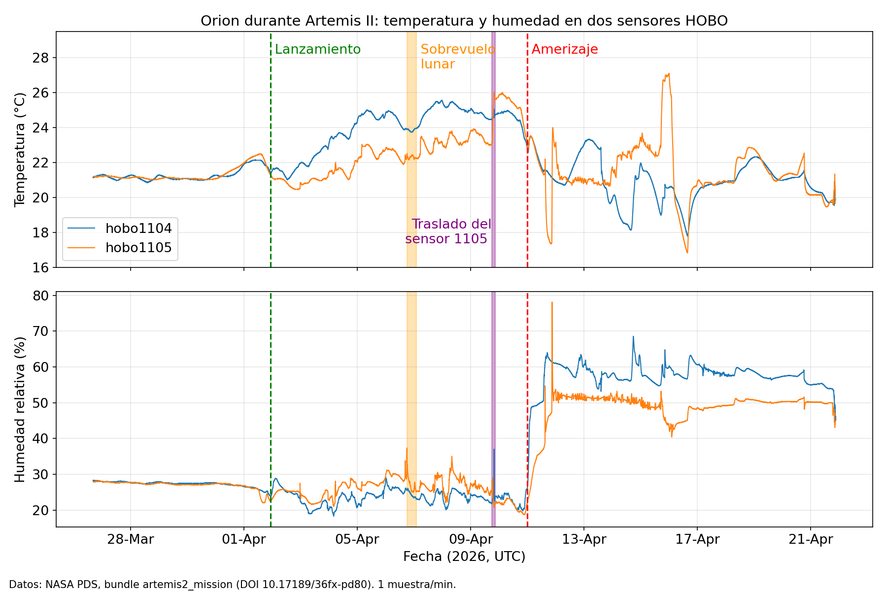

# Artemis II: análisis de datos científicos públicos de NASA

*English summary: personal analysis of public NASA PDS data from Artemis II (temperature and humidity logs from inside Orion), with a reproducible notebook.*

Análisis de los datos científicos lunares que NASA publicó en el PDS el 7 de octubre de 2026. Empiezo por los registros más pequeños y verificables: dos sensores de temperatura y humedad dentro de Orion (HOBO).

## Qué contiene

- `notebooks/01_inventario.ipynb`: carga, control de calidad, figura y primera lectura del Outgoing Target Request (OTR).
- `figures/`: figuras generadas por el notebook.
- `log.md`: diario de trabajo.

## Datos y fuentes

- Bundle `artemis2_mission` (PDS Geosciences Node): DOI 10.17189/36fx-pd80
- Guía de datos: *Artemis II Lunar Science Data User Guide* v1.0, DOI 10.17189/dtpt-2857
- Descarga: https://pds-geosciences.wustl.edu/artemis2/urn-nasa-pds-artemis2_mission/

Los datos no se incluyen en este repositorio. Hay que descargarlos de la fuente.

## Cómo reproducirlo

1. Descarga de las carpetas `data_orion_environment` y `document` del bundle: los dos CSV de `hobo1104` y `hobo1105`, y `artemis2_outgoing_target_request.json`.
2. Abre `notebooks/01_inventario.ipynb` en Google Colab (Archivo → Subir cuaderno).
3. Ejecuta las celdas en orden y sube los tres archivos cuando se pida.

Entorno usado: Google Colab, pandas 2.2.3, matplotlib 3.10.0.

## Qué muestran los datos

- Antes del lanzamiento, los dos sensores coinciden (~21 °C, ~28 % de humedad relativa).
- Iban en compartimentos distintos (1104 en el locker E; 1105 en el D hasta el 9 de abril y luego en el F, según la guía, sec. 3.4).
- Hasta el traslado, el 1104 marca de media 1,8 °C más que el 1105. El 10 de abril la diferencia cambia de signo.
- Tras el amerizaje, la humedad pasa de ~20-25 % a 50-60 %.

## Limitaciones

- Son dos sensores y un análisis descriptivo. No se demuestran causas.
- Los datos son crudos (sin calibrar ni limpiar por NASA).
- Sigue sin explicarse por qué el locker D era más frío que el E, ni las excursiones del sensor 1105 los días 15-16 de abril.
- No he analizado imágenes ni audio. El significado de los flags STM del OTR está por confirmar en la documentación de la misión.

## Atribución

Datos: NASA / Planetary Data System. Este proyecto es personal y no está afiliado a NASA.

Autor: Jorge Rodríguez · Madrid